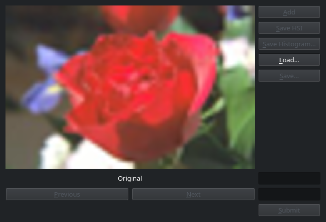

# image-processing-from-scratch

[](https://github.com/Wil12Fred/image-processing-from-scratch/actions/workflows/ci.yml) [](LICENSE)

Image-processing algorithms implemented from scratch in C++ on top of nothing but libpng:
point operations, spatial filters, a hand-written radix-2 FFT with frequency-domain and
Wiener filtering, and binary morphology, with a small Qt 5 viewer to try them out.

| Original | Sobel filter |
|---|---|
|  |  |

*Screenshots taken on Linux with ImageMagick's built-in `rose:` sample as input.*

## Features

- Point operations: grayscale, black and white, negative, log and power transforms.
- Histogram and HSI export to CSV.
- Recursive radix-2 FFT, 2-D FFT and inverse, with zero padding to a power of two.
- Spatial filters: mean/weighted mean, median, Sobel, Roberts, Laplace, Gaussian,
  directional (horizontal, vertical, ±45°), and a partial Canny (Gaussian + Sobel).
- Frequency filters: Fourier filtering and Wiener deconvolution.
- Morphology: dilation, erosion, opening, closing, and edge (dilation − erosion).
- Two programs over the same header-only code:
  - **`procimg-gui`** — a Qt 5 viewer: load a PNG, step through the operations with
    *Previous*/*Next* to preview each one, *Add* to apply it, then save the result or
    export its histogram / HSI values. It is built from Qt's *Address Book* tutorial,
    which is why the window and the class are still called that.
  - **`procimg`** — a command-line batch (`main.cpp`): it sums four directional edge
    images into one. The longer Fourier/Wiener/morphology pipeline is kept commented out.

## Requirements

| | Debian / Ubuntu | Arch Linux |
|---|---|---|
| compiler, make, pkg-config | `g++ make pkg-config` | `gcc make pkg-config` |
| libpng | `libpng-dev` | `libpng` |
| GUI (Qt 5, qmake) | `qtbase5-dev` | `qt5-base` |
| tests (GUI smoke run) | `xvfb` | `xorg-server-xvfb` |

## Build

```sh
make          # ./procimg            (command line)
make gui      # ./build/procimg-gui  (Qt 5)
make all      # both
```

## Run

**The batch** reads `camahorizontal.png`, `camavertical.png`, `cama45p.png` and
`cama45n.png` (8-bit RGB/RGBA) from the current directory, thresholds the first, adds the
others and writes `sumlena.png`. The original course images are not in the repository;
`tests/data/` has four generated 16×16 ones:

```sh
cd tests/data && ../../procimg && ls sumlena.png
```

```
sumlena.png
```

Without the inputs it stops with:

```
camahorizontal.png: No such file or directory
procimg: cannot read camahorizontal.png; the batch needs camahorizontal.png, camavertical.png, cama45p.png and cama45n.png (8-bit RGB/RGBA PNGs) in the current directory
```

**The GUI** opens `./lena.png` from the current directory as its startup image (not
included; any PNG renamed works), then use *Load...* to choose any PNG:

```sh
./build/procimg-gui
```

It writes its working copies to `.temp.png` and `.edited.png` in the current directory.

## Tests

```sh
make all test
```

- `tests/test_filters.cpp` — unit and golden tests on images built in memory: FFT of an
  impulse and of `[1,2,3,4]` against the known spectra, the DC term of a constant 2-D
  image, forward→inverse 2-D FFT round trip, and the image-level `to_fourier` /
  `fourier_to_image` round trip on a 13×10 image padded to 16×16; Sobel and Laplace on a
  vertical step edge against hand-computed values; median removes a salt pixel; mean keeps
  a constant image; negative and threshold; dilation of a pixel gives a 3×3 block and
  erosion of that block gives the pixel back; the histogram counts intensity 255; the HSI
  export gives hue 0, 2π/3, 4π/3 for the primaries; PNG write→read round trip; `sum()`
  accumulates. It runs in `tests/run/`.
- `tests/run_programs.sh` — `procimg` without inputs exits 1 with a message;
  `procimg` on `tests/data/` produces the same pixels as `tests/expected/sumlena.png`;
  `procimg-gui` starts and keeps running for 5 s on a private `xvfb-run` display.

## Project layout

| File | Contents |
|---|---|
| `io_png.h` | PNG load/save (libpng), shared global image buffers |
| `basic_png.h` | point operations, sum, histogram and HSI export, complex ↔ image |
| `fourier.h` | recursive radix-2 FFT and 2-D FFT |
| `filter_png.h` | spatial and frequency filters, Wiener deconvolution, Canny |
| `morpho_png.h` | dilation, erosion, opening, closing, edge |
| `functions_png.h` | globals + includes all of the above |
| `addressbook.*`, `finddialog.*`, `gui_main.cpp` | Qt interface |
| `main.cpp` | command-line batch |
| `tests/` | unit tests, program runs, generated input images, expected output |

## Known limitations

- All state lives in global buffers, and every `load_file` allocates new ones without
  freeing the old ones.
- Only 8-bit RGB/RGBA PNGs are accepted (no grayscale or palette images).
- Filters leave a border of the filter's half-width untouched.
- Canny stops after Gaussian + Sobel: no non-maximum suppression or hysteresis.
- The HSI export divides by the intensity, so pure black pixels give `nan` saturation.
- Qt 5 is end-of-life; the GUI has not been ported to Qt 6.
- Fixed in this pass (each with a test): `sum()` discarded the accumulated image because
  `load_file` replaces the output buffer, so the batch wrote twice the last image instead
  of the sum; the histogram array had 255 entries for 256 intensities; the HSI hue used
  the wrong formula and the wrong `b > g` test; and the batch aborted inside libpng when
  an input was missing.

## Background

Written in 2019 for an image-processing course at university.

## License

MIT — see [LICENSE](LICENSE).
