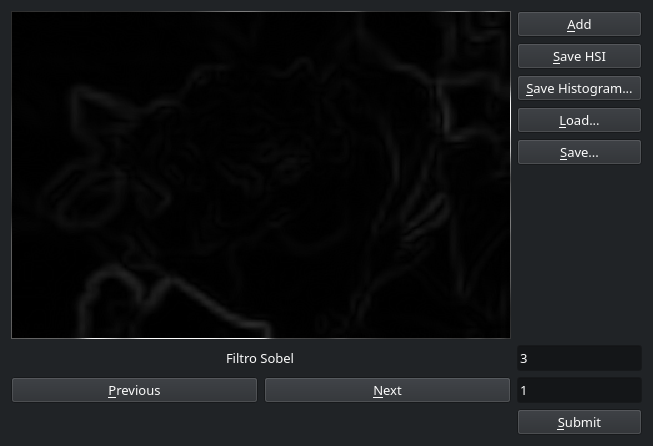

# image-processing-from-scratch

> Procesamiento de Imágenes

Image-processing algorithms implemented from scratch in C++ on top of libpng, for an
image-processing course (2019). The repository has two programs over the same header-only
code:

- **`procimg-gui`**: a Qt 5 viewer. Load a PNG, step through the operations with
  *Previous*/*Next* to preview each one, *Add* to apply it, then save the result or export
  its histogram / HSI values as CSV. It is built from Qt's *Address Book* tutorial, which
  is why the window and the class are still called that.
- **`procimg`**: a command-line batch (`main.cpp`). As committed, it sums four
  directional edge images (`camahorizontal.png`, `camavertical.png`, `cama45p.png`,
  `cama45n.png`) and writes `sumlena.png`. The longer Fourier/Wiener/morphology pipeline
  is kept commented out below it.

| Original | Sobel filter |
|---|---|
|  |  |

*Screenshots taken on Linux with ImageMagick's built-in `rose:` sample as input.*

Operations: grayscale, black and white, negative, log and power transforms,
2-D FFT and its inverse, mean/weighted mean, median, Sobel, Roberts, Laplace, Fourier
filtering, Wiener deconvolution, dilation, erosion, opening, closing, morphological edge
(dilation − erosion), directional filters (horizontal, vertical, ±45°) and a partial Canny (Gaussian + Sobel, no hysteresis).

## Build

Needs a C++11 compiler and libpng (`sudo apt install libpng-dev`). The GUI also needs
Qt 5 (`sudo apt install qtbase5-dev`).

```sh
make          # ./procimg       (command line)
make gui      # ./build/procimg-gui
```

## Run

**The GUI** opens `./lena.png` from the current directory as its startup image (not
included). Then use *Load...* to choose any PNG.

```sh
./build/procimg-gui
```

It writes its working copies to `.temp.png` and `.edited.png` in the current directory.

**The batch** needs the four input images in the current directory:

```sh
./procimg            # -> sumlena.png
```

Without them it prints `camahorizontal.png: No such file or directory` and aborts inside
libpng. The original course images are not in the repository.

## Layout

| File | Contents |
|---|---|
| `io_png.h` | PNG load/save (libpng), shared global image buffers |
| `basic_png.h` | point operations, sum, histogram and HSI export, complex ↔ image |
| `fourier.h` | recursive radix-2 FFT and 2-D FFT |
| `filter_png.h` | spatial and frequency filters, Wiener deconvolution, Canny |
| `morpho_png.h` | dilation, erosion, opening, closing, edge |
| `functions_png.h` | globals + includes all of the above |
| `addressbook.*`, `finddialog.*`, `gui_main.cpp` | Qt interface |
| `main.cpp` | command-line batch |
